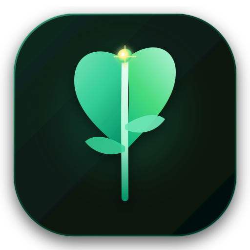
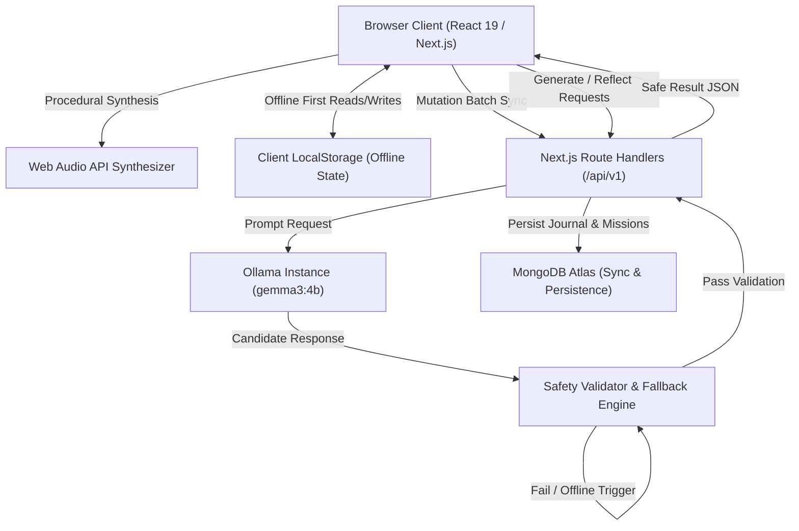

# 🌿 WildSense

<p align="center">
  
</p>

<p align="center">
  <strong>An offline-first sensory nature companion combining guided outdoor mindfulness micro-missions, an in-browser ambient soundscape synthesizer, and private local AI reflections.</strong>
</p>

<p align="center">
  <a href="#-key-features"></a>
  <a href="#-key-features"></a>
  <a href="#-key-features"></a>
  <a href="#-key-features"></a>
  <a href="#-key-features"></a>
  <a href="#-key-features"></a>
  <a href="#-key-features"></a>
  <a href="#-license"></a>
</p>

---

## 📖 Table of Contents
- [Overview](#-overview)
- [Key Features](#-key-features)
- [System Architecture](#-system-architecture)
- [Tech Stack](#-tech-stack)
- [Project Structure](#-project-structure)
- [REST API Reference (v1)](#-rest-api-reference-v1)
- [Safety & Guardrail Pipeline](#-safety--guardrail-pipeline)
- [Getting Started](#-getting-started)
  - [Prerequisites](#prerequisites)
  - [Installation & Setup](#installation--setup)
  - [Environment Variables](#environment-variables)
  - [Running Locally](#running-locally)
- [Testing & Quality Assurance](#-testing--quality-assurance)
- [Production Deployment](#-production-deployment)
  - [Deploying to Render](#deploying-to-render)
  - [Self-Healing Start Script](#self-healing-start-script)
- [Demo Walkthrough](#-demo-walkthrough)
- [License](#-license)

---

## 🌲 Overview

In an era of relentless notifications and digital fatigue, **WildSense** is engineered to turn screens into gentle springboards toward the living world. Rather than encouraging mindless scrolling, WildSense delivers **5- to 15-minute contemplative outdoor micro-missions** designed to reawaken human sensory awareness—touch, hearing, sight, and scent.

### Core Philosophy
1. **Offline-First by Design**: Nature does not have 5G bars. Missions, the wall-clock field timer, and local field journals operate 100% offline using client state and local storage.
2. **Privacy-Preserving On-Device AI**: Contemplative reflections and dynamic mission creation are powered locally by Ollama running Google's `gemma3:4b`, keeping personal thoughts strictly on your device.
3. **Leave No Trace & Ethical Safety**: A deterministic, multi-layer safety validator prevents harmful foraging, dangerous terrain navigation, or wildlife disturbance before any AI output is presented to the user.
4. **Bandwidth-Free Procedural Audio**: Ambient soundscapes (wind, warblers, rain, meadow brook, evening crickets) are synthesized in real time via the Web Audio API without requiring megabytes of audio stream downloads.

---

## ✨ Key Features

### 🌿 Guided Sensory Nature Missions
- Curated catalog of micro-missions across five distinct sensory categories: **Sound**, **Touch**, **Sight**, **Breath**, and **Discovery**.
- Mission briefing with step-by-step guidance, sensory focus directives, curiosity facts, and grounded reflection prompts.
- **Active Countdown Field Timer**: Persistent, wall-clock timer designed to run uninterrupted even when switching browser tabs outdoors.

### 🎧 In-Browser Procedural Soundscape Synthesizer
- Real-time procedural audio engine crafted with Web Audio API nodes (`BiquadFilterNode`, `GainNode`, Pink/White noise buffers, low-frequency oscillators).
- **Four Ambient Presets**:
  - 🌲 **Canopy Wind & Birds**: Swaying hemlock boughs with organic, random distant warbler calls.
  - 💧 **Meadow Brook**: Cool mountain stream with bubbling water tumbling across mossy stones.
  - 🌧️ **Gentle Rain**: Calm rhythmic rainfall pattering softly on canopy foliage.
  - 🦗 **Twilight Crickets**: Dusk ambiance with chirping field crickets and evening breeze.
- Floating glassmorphism mini-player with quick pause/resume, channel volume mixing, and full expansion drawer.

### 🤖 Local AI Nature Reflections & Generator
- Integrated with **Ollama** running `gemma3:4b`.
- Tailor unique missions based on available time (5, 10, or 15 mins), local terrain (park, forest, riverbank, urban garden), and sensory focus.
- Generates post-mission poetic reflections analyzing user observations through an ecological lens.
- **Instant Fallback**: If Ollama is offline or uninstalled, an internal deterministic naturalist generator automatically provides curated, safe responses.

### 🛡️ Multi-Layer Safety Guardrails
- Rigorous regex and heuristic validator blocks hazardous prompts:
  - ❌ Ingestion, foraging for wild food, tasting unknown flora/fungi.
  - ❌ Approaching, touching, or disturbing wildlife, nests, or hives.
  - ❌ Trespassing on private property, climbing fences or restricted gates.
  - ❌ Hazardous terrain (steep cliffs, cave exploration, swift water/swimming).
  - ❌ Destructive actions (uprooting living flora, stripping bark).
  - ❌ Unsolicited psychiatric or medical diagnoses.

### 📓 Field Journal with Cloud Sync
- Markdown-friendly outdoor journal with mission tagging, sensory notes, and completion stamps.
- **Bidirectional Sync Engine**: Client tracks mutation queues (`wildsense:v1`) and synchronizes with MongoDB Atlas whenever a network connection becomes available.
- Export journal entries to JSON and restore from backup files anytime.

### 🌓 Handcrafted Nature Aesthetic & Responsive UI
- Bespoke typography and organic color palette: **Moss**, **Sage**, **Earth**, **Sand**, and **Stone**.
- High-contrast accessible components with seamless dark/light theme switching.
- Custom vector sprout branding (`app/icon.svg`, `public/favicon.ico`, `public/apple-touch-icon.png`).

---

## 🏗️ System Architecture

### High-Level System Flow


### Sync Engine Lifecycle
```mermaid
sequenceDiagram
    autonumber
    actor User as Outdoor Explorer
    participant UI as WildSense Client
    participant Store as Local Storage
    participant API as /api/v1/sync
    participant DB as MongoDB Atlas

    User->>UI: Completes mission & records journal note
    UI->>Store: Append to local mutation queue (offline safe)
    Note over UI,Store: Note available immediately in UI

    alt Network Connected
        UI->>API: POST /api/v1/sync (payload: mutations, clientId)
        API->>DB: Process mutations with atomic version check
        DB-->>API: Acknowledge & return cloud changes
        API-->>UI: Sync successful { status: 'synced', version: n }
        UI->>Store: Clear flushed mutation queue
    else Network Offline
        UI->>UI: Display "Offline Ready" badge; queue retained
    end
```

---

## 🛠️ Tech Stack

| Layer | Technologies |
| :--- | :--- |
| **Framework** | [Next.js 15.5](https://nextjs.org/) (App Router, Server Actions, Route Handlers) |
| **UI Library** | [React 19](https://react.dev/), [Radix UI](https://www.radix-ui.com/), [Lucide React](https://lucide.dev/) |
| **Styling** | [Tailwind CSS 3.4](https://tailwindcss.com/) with CSS Variables & Glassmorphism |
| **Audio Engine** | Native **Web Audio API** (Oscillators, Biquad Filters, Pink Noise Generators) |
| **Local AI** | [Ollama](https://ollama.com/) with `gemma3:4b` |
| **Database** | [MongoDB](https://www.mongodb.com/) (Native Driver 6.x) with indexed collections |
| **Validation** | [Zod 3.25](https://zod.dev/) runtime schemas |
| **Testing** | [Vitest 5.0](https://vitest.dev/) (Unit & Integration tests) |
| **Runtime & Package Manager** | [Bun](https://bun.sh/) & [Node.js 20+](https://nodejs.org/) |

---

## 📁 Project Structure

```
wildsense-nextjs/
├── app/                              # Next.js App Router
│   ├── api/                          # Backend API Route Handlers
│   │   ├── v1/                       # Versioned REST endpoints
│   │   │   ├── ai/status/            # Ollama connectivity status
│   │   │   ├── health/live & ready/  # K8s/Docker liveness probes
│   │   │   ├── journal/              # Journal CRUD endpoints
│   │   │   ├── missions/             # Mission queries & AI generation
│   │   │   ├── reflections/          # Post-mission reflection synthesis
│   │   │   └── sync/                 # Offline mutation sync endpoint
│   │   ├── health/                   # Legacy health endpoint
│   │   ├── mission/                  # Legacy mission endpoint
│   │   └── reflect/                  # Legacy reflect endpoint
│   ├── journal/                      # Field Journal page (/journal)
│   ├── mission/[id]/                 # Active Mission Briefing & Timer (/mission/...)
│   ├── favicon.ico                   # Multi-resolution botanical favicon
│   ├── icon.svg                      # Sprout vector favicon
│   ├── layout.tsx                    # Root layout with theme provider & headers
│   └── page.tsx                      # Home showcase, mission generator & catalog
├── public/                           # Public static assets & favicon bundles
├── render.yaml                       # Cloud deployment blueprint for Render.com
├── scripts/
│   └── start.js                      # Production startup script with self-healing build
├── src/
│   ├── assets/                       # Nature imagery (hero, meadow, moss, river)
│   ├── components/
│   │   ├── ui/                       # Radix-based UI building blocks
│   │   └── ws/                       # WildSense domain components
│   │       ├── MissionGenerator.tsx  # Dynamic AI mission generation widget
│   │       ├── SiteHeader.tsx        # Navigation header with soundscape trigger & theme toggle
│   │       ├── SoundscapePlayer.tsx  # Procedural Web Audio sound generator
│   │       ├── SyncStatusBadge.tsx   # Offline/Online sync indicator
│   │       └── ui.tsx                # Custom badges, cards, buttons
│   ├── data/
│   │   └── missions.ts               # Core curated offline nature missions
│   ├── hooks/                        # Custom React hooks (use-mobile, etc.)
│   ├── lib/
│   │   ├── api/                      # Client-side API fetch wrappers
│   │   ├── store.ts                  # Local storage reactive state (useSyncExternalStore)
│   │   ├── types.ts                  # Shared domain types
│   │   └── utils.ts                  # Class merge (clsx / tailwind-merge)
│   └── server/                       # Backend architecture
│       ├── ai/                       # Ollama client, safety validator, fallbacks
│       ├── config/                   # Environment variable loader
│       ├── database/                 # MongoDB client & collection indexers
│       ├── middleware/               # In-memory rate limiting & error handling
│       ├── repositories/             # MongoDB data repositories
│       ├── schemas/                  # Zod validation schemas
│       └── services/                 # Domain business logic services
├── tests/                            # Vitest unit & integration test suites
│   ├── fallback-generator.test.ts
│   ├── rate-limiter.test.ts
│   ├── safety-validator.test.ts
│   └── schemas.test.ts
├── package.json                      # Dependency declarations & npm scripts
├── tsconfig.json                     # TypeScript compiler configuration
└── vitest.config.ts                  # Test runner configuration
```

---

## 🔌 REST API Reference (v1)

All endpoints accept and return JSON with standard HTTP status codes (`200`, `201`, `400`, `429`, `500`).

### 1. Missions
| Method | Endpoint | Description |
| :--- | :--- | :--- |
| `GET` | `/api/v1/missions` | Query missions with optional filters (`category`, `difficulty`, `search`). |
| `GET` | `/api/v1/missions/:id` | Fetch specific mission briefing by ID. |
| `POST` | `/api/v1/missions/generate` | Generate a customized mission via Ollama (or deterministic fallback). |

#### Sample Payload: `POST /api/v1/missions/generate`
```json
{
  "terrain": "forest",
  "durationMinutes": 10,
  "category": "sound",
  "preferredSensoryFocus": "hearing"
}
```

---

### 2. Field Journal
| Method | Endpoint | Description |
| :--- | :--- | :--- |
| `GET` | `/api/v1/journal` | Fetch paginated journal entries (`page`, `limit`). |
| `POST` | `/api/v1/journal` | Create a new journal entry. |
| `PATCH` | `/api/v1/journal/:id` | Update an existing journal entry note or tags. |
| `DELETE` | `/api/v1/journal/:id` | Remove a journal entry. |

---

### 3. Reflections
| Method | Endpoint | Description |
| :--- | :--- | :--- |
| `POST` | `/api/v1/reflections` | Submit field observations to receive a safe naturalist reflection. |
| `GET` | `/api/v1/reflections/:journalId/status` | Check generation status of an asynchronous reflection. |

---

### 4. Synchronization & Health
| Method | Endpoint | Description |
| :--- | :--- | :--- |
| `POST` | `/api/v1/sync` | Process client mutation queue and return cloud changes. |
| `GET` | `/api/v1/ai/status` | Returns connectivity status of the local Ollama daemon. |
| `GET` | `/api/v1/health/live` | Liveness probe returning HTTP 200 OK. |
| `GET` | `/api/v1/health/ready` | Readiness probe checking MongoDB connection and system health. |

---

## 🛡️ Safety & Guardrail Pipeline

WildSense prioritizes outdoor ethics and human safety. Every AI-generated output passes through `src/server/ai/output.validator.ts`:

```
User Request ──► Ollama (gemma3:4b) ──► Candidate Output
                                              │
                    ┌─────────────────────────┴────────────────────────┐
                    ▼                                                  ▼
           [Pattern Inspection]                               [Schema Inspection]
     - Ingestion / Wild Food Tasting?                  - Valid JSON structure?
     - Touching / Approaching Wildlife?                - Title, steps & facts present?
     - Steep Cliffs / Fast Water Hazards?              - Steps count >= 2?
     - Trespassing / Restricted Property?                              │
                    │                                                  │
                    └─────────────────────────┬────────────────────────┘
                                              ▼
                                       Safety Decision
                                       ├── Pass: Return generated mission
                                       └── Fail: Discard & return safe deterministic fallback
```

---

## 🚀 Getting Started

### Prerequisites
- **Node.js**: v20.9.0+ or **Bun**: v1.1.0+
- **Ollama**: (Optional for local AI) Download from [ollama.com](https://ollama.com/)
- **MongoDB**: (Optional for cloud sync) Local MongoDB instance or free MongoDB Atlas URI

### Installation & Setup

1. **Clone the repository**:
   ```bash
   git clone https://github.com/Abhishek-IITP/wildsense.git
   cd wildsense
   ```

2. **Install dependencies**:
   ```bash
   bun install
   # or
   npm install
   ```

3. **Configure Environment Variables**:
   Create a `.env` file in the root directory:
   ```env
   # Database (Optional for cloud persistence)
   MONGODB_URI=mongodb+srv://<username>:<password>@cluster0.example.mongodb.net/
   MONGODB_DB=wildsense

   # Local AI (Optional - falls back to deterministic generator if omitted)
   OLLAMA_BASE_URL=http://127.0.0.1:11434
   OLLAMA_MODEL=gemma3:4b
   ```

4. **Pull the Local AI Model (Optional)**:
   ```bash
   ollama pull gemma3:4b
   ollama serve
   ```

### Running Locally
```bash
# Start development server
bun run dev
# or
npm run dev
```

Open [http://localhost:3000](http://localhost:3000) in your browser.

---

## 🧪 Testing & Quality Assurance

WildSense maintains comprehensive automated test coverage with **Vitest**:

```bash
# Run all tests
bun x vitest run
# or
npm run test
```

### Test Suites Included:
- **`safety-validator.test.ts`**: Verifies strict rejection of toxic foraging, wildlife interference, and dangerous terrain prompts.
- **`fallback-generator.test.ts`**: Verifies deterministic offline fallback generation when Ollama is unavailable.
- **`schemas.test.ts`**: Validates Zod payload constraints for missions, journals, and reflections.
- **`rate-limiter.test.ts`**: Verifies IP-based sliding window rate-limiting for backend API protection.

---

## 🚢 Production Deployment

### Deploying to Render
A pre-configured [`render.yaml`](render.yaml) blueprint is included in the repository.

1. Create a **Web Service** on [Render.com](https://render.com/).
2. Connect your Git repository.
3. Configure the settings:
   - **Environment**: `Node`
   - **Build Command**: `bun install && bun run build` *(or `npm install && npm run build`)*
   - **Start Command**: `bun run start` *(or `npm start`)*
4. Under **Environment Variables**, add:
   - `NODE_ENV`: `production`
   - `MONGODB_URI`: *Your MongoDB connection string*
   - `MONGODB_DB`: `wildsense`

### Self-Healing Start Script
The production start command points to [`scripts/start.js`](scripts/start.js). If a deployment environment accidentally executes `start` without having pre-built the `.next` artifacts, the script automatically:
1. Detects the missing `.next/BUILD_ID`.
2. Triggers `next build` before spinning up the server.
3. Automatically binds to the container's assigned `$PORT` (e.g. Render's default port `10000`).

---

## 🎬 Demo Walkthrough

Follow these steps to explore WildSense's core capabilities:

1. **Homepage & Soundscape**:
   - Open [http://localhost:3000](http://localhost:3000).
   - In the top navigation bar or bottom dock, click the **Soundscape** icon.
   - Switch between **Canopy Wind & Birds**, **Meadow Brook**, and **Gentle Rain**. Listen to the Web Audio synthesizer adjust real-time frequencies.
2. **AI Mission Generator**:
   - Scroll to the **Generate Your Mission** section on the homepage.
   - Select your location (e.g., *Forest* or *City Park*), time (*10 Minutes*), and focus (*Sound*).
   - Click **Generate Mission** to experience on-device generation with instant safety filtering.
3. **Active Mission & Field Timer**:
   - Click **Start Mission** on any card (e.g., *Canopy Whisper*).
   - Follow the step-by-step sensory instructions and start the countdown timer.
4. **Field Journal & Sync**:
   - Navigate to `/journal`.
   - Record your sensory observations from the mission.
   - Observe the **Sync Status** indicator seamlessly updating between local storage and the database.

---

## 📄 License

This project is licensed under the **MIT License**. See the [LICENSE](LICENSE) file for complete details.

---

<p align="center">
  Crafted with care for nature lovers, mindful explorers, and outdoor enthusiasts. 🌱
</p>
